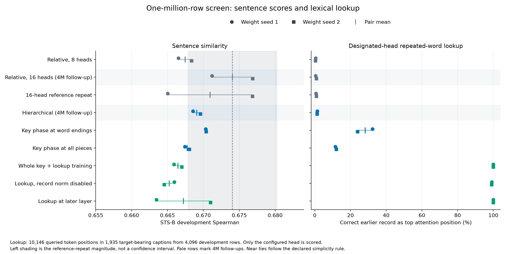
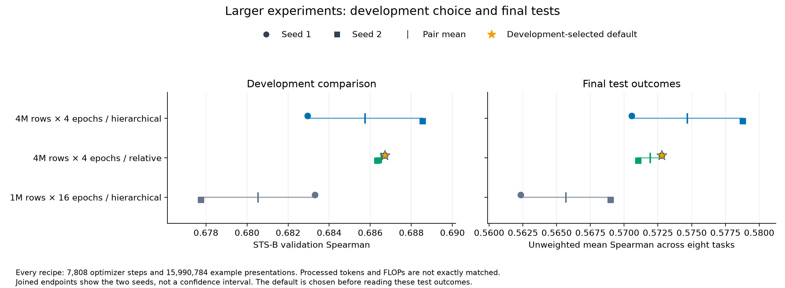

# Structured rotary CaptionBERT: precise word reads and the sentence-embedding test

The complete whole-key rotary mechanism learned an extremely precise word-record read inside the full CaptionBERT encoder. Under both weight seeds, its designated attention head returned the correct earlier record for every one of the 10,146 sampled query positions. The probability assigned to that record averaged about 0.99951. The result held across word endings, non-ending pieces, continuation pieces and the sampled longer captions within the training length range.

The sentence-embedding result was more restrained. The complete binding package did not become the strongest sentence encoder in the screen. Its original pair mean was about 0.00759 below the selected sixteen-head relative reference, slightly outside the declared comparison band for those original pairs. The reference repeat itself showed wider seed variation, so that ordering deserves replication rather than a broad verdict. The matched feature comparisons did not identify a reliable sentence-score benefit from adding whole-key binding or its lookup term.

The larger stage compared the selected hierarchical architecture and relative reference on four million paired caption rows, with two seeds each. It also trained the hierarchical architecture on one million rows for the same number of optimizer steps. That third pair matters: more data and more training time are different explanations, and the shorter screen alone cannot distinguish them.

The completed four-million-row pairs averaged 0.68575 for the hierarchical model and 0.68652 for the relative reference on sentence development. Their gap of 0.00078 is a near tie under the declared comparison rule. The simpler relative model, seed 1, becomes the default release. Both hierarchical models and the complete word-binding screen pair remain available. The following results separate that practical choice from the stronger lookup result and from the remaining uncertainty about additional data.

This is a transfer experiment with a complete encoder. The earlier rotary result came from a causal byte model that writes records and reads addresses. CaptionBERT receives a complete caption and produces one sentence vector. The implementation retains the source's three-level address layout, record-key normalization, value-address path and key phase at every word piece in its complete option. Its tokenizer, record definition and training objective are explicitly adapted to this different task.

Lookup supervision rewards an exact earlier word read. Sentence development rewards pooled distances that agree with human similarity judgments. The experiment measures both and selects a sentence encoder using the latter.

| Question | Evidence used here |
|---|---|
| Did the complete adapted head perform its assigned read? | Exact-record attention on the same held-out caption queries under both seeds |
| Did that read improve sentence similarity? | Paired STS-B development comparisons, followed by the locked final test tables |
| Did four million rows help beyond taking more steps? | The hierarchical four-million-row and matched-exposure one-million-row pairs |
| Which trained components are used at inference? | Frozen removals and redraws on development data |
| Does the released model reproduce the trained checkpoint? | Independent tensor equality and actual native/AutoModel output comparisons |

The resulting release keeps the strongest measured sentence choice and the complete binding models available as distinct outcomes. The rest of this report explains what changed, what the measurements establish and which comparisons would make the next stage more informative. The [technical companion](TECHNICAL_STRUCTURED.md) contains exact formulas, configuration identities, data routes, numerical tolerances and artifact locations.

## What moved into the encoder

The starting point was the final whole-key rotary system in the earlier record-addressing experiments. Its address layout, record normalization, value path and whole-key binding were treated as a connected mechanism. The implementation reference is [trainer v0.1.103](https://github.com/AbstractEyes/geolip-nano-beatrix-trainer/tree/3f174e3f391f983428171cefc6901b34b22274d8). The [published final source record](https://huggingface.co/AbstractPhil/geolip-rotary-experiments/blob/f99d3cbadeb2a75ae27bdbcbb8fbc05fd3f6f076/README.md) documents six successful seeds at 512 addresses. That pinned revision supplies the source evidence used here.

The earlier result belongs to a causal byte model with an explicit record-writing and address-reading task. CaptionBERT receives a complete caption and produces a sentence vector. Moving the mechanism changes the meaning of a record, the tokenizer and the task that supplies its gradients. Those changes matter as much as the rotation formula. The earlier model's success establishes a useful starting design; this experiment has to establish what the adapted encoder actually does.

The student keeps twelve transformer layers, width 512 and a feed-forward width of 2,048. A masked mean over valid token states feeds a learned 512-to-512-to-768 projection. The final sentence vector is normalized to length one. Token states retain width 512. Relative controls have 54,114,560 parameters; the structured models have 54,126,848. The difference is a 12,288-parameter value-address table.

The structured options use sixteen attention heads, giving each head 32 coordinates. This preserves the source's sixteen two-coordinate rotation planes. Two planes carry relative position, two carry unrotated content and twelve carry the address: four planes for each of three base-eight digits. The digits provide 512 possible segment addresses, with a separate ninth value for a missing or overflowing digit. The original eight-head relative encoder is retained as a control, and a sixteen-head relative encoder supplies a closer head-width comparison.

Changing the head count keeps the sizes of the learned query, key, value and output projections the same. It changes how their coordinates are divided into heads. The eight-head and sixteen-head relative controls also differ in frequency scaling. Their comparison therefore measures that package of changes. It cannot identify a separate effect of head count or of NTK-style scaling.

The structural address is derived from punctuation-delimited segments. A boundary punctuation token belongs to its preceding segment; the next token begins the next one. This is a deterministic segmentation rule rather than a linguistic sentence parser. Each segment number is written as three base-eight digits. The value path adds learned vectors for those digits to the input token representation. Those tables start at zero and train with the encoder.

A natural caption does not arrive with the record-and-request frame of the byte experiment. The adaptation uses repeated words. A key is the complete WordPiece token sequence of a word. Case distinctions removed by the uncased tokenizer are outside that identity definition. Its first occurrence's ending is a record. Later occurrences provide query positions. Common function words, keys without an alphabetic character and keys shorter than three characters are excluded from the auxiliary target set. The main caption objective uses every caption input, including inputs without eligible repeated-word targets; the shared 256-token ceiling still applies.

Every piece available in the input contributes to its word’s fixed key phase. The phase construction adds no shorter key-length cutoff; tokenization can still clip a word at the input ceiling. A deterministic counter hash over token identity and reverse offset replaces the source's byte-and-offset phase table. Equal token sequences receive equal phases, including at their non-ending pieces. This is an explicit tokenizer adaptation, not the original phase draw. Training targets are generated independently from exact token tuples, so a hash collision would not quietly redefine which record is correct.

The designated lookup head uses the key-derived angles at its bound positions. The remaining attention heads keep their positional and address rotations. One option binds at word endings; another binds at every piece. At the first occurrence's ending, the complete design holds each key pair to the source's fixed length of 2.18. That operation applies to record keys. A separate control removes it. Direct lookup supervision, where enabled, asks the configured head to place attention on the earlier first-occurrence ending. Another option moves that supervised lookup from the fourth layer to the eighth.

The encoder sees the entire input. It can construct a whole word's identity from all its pieces even at an early piece. That is a legitimate operation for this bidirectional model. It does not establish streaming retrieval before the rest of a word has arrived, or reproduce the earlier causal task.

The connection to ordinary rotary position embedding is the use of rotations to control query-key comparisons. [RoFormer](https://arxiv.org/abs/2104.09864v5) gives the standard positional construction. Here the addresses and whole-key phases add different information to particular coordinate planes and heads. The exact frequencies, half-split coordinate convention, null address and normalization are specified in the technical companion and preserved in the saved model configuration.

## What the data exercises

The initial inspection used 4,096 real captions from the first training chunk, tokenized with the 256-token training ceiling. Median length was 33 tokens; the ninetieth percentile was 118 and the ninety-ninth was about 178. There were 272 rows above 128 tokens and ten at the ceiling. The median segment count was two, the ninety-ninth percentile was nine and the maximum was fifteen.

That sample contained 2,026 captions with eligible repeated words and 11,120 supervised query positions, including 707 continuation-piece queries. Independently constructed token-tuple targets agreed with the model's key and record construction on every checked query. This inspection established that the proposed task occurs in real inputs and that its labels matched the intended mechanism. It is a first-chunk descriptive sample, not a claim about the entire corpus.

The short segments also place a strong limit on interpretation. Most inputs use only a small part of the three-digit address. When a digit is constant throughout a caption, its common rotation cancels in a query-key dot product. The larger address digits therefore contribute little changing positional information on most of these captions. The experiment exercises natural repeated-word lookup and short-text representation, while leaving much of the source's address capacity untested.

The training examples come from the existing [caption dataset](https://huggingface.co/datasets/AbstractPhil/conceptual-captions-12m-webdataset-berts) and [five-teacher consensus targets](https://huggingface.co/datasets/AbstractPhil/captionbert-8192-v2-consensus). Each caption is paired with the target at exactly the same row index. Available chunks are checked against their fixed source revisions and file hashes. There is no image-number join, row division or four-teacher fallback.

The teachers are BERT-base, ModernBERT-base, RoBERTa-base, ALBERT-base and DistilBERT. The cached consensus was constructed by aligning the teachers to the BERT reference frame and normalizing their centroid, as described by the [original CaptionBERT v2 card](https://huggingface.co/AbstractPhil/captionbert-8192-v2/blob/ed468fe5aed64a3d03a56a7f7811131d20f81ddb/README.md). This campaign consumes the published targets. It does not refit an alignment map on its development or test examples.

The screen uses exactly one million available paired rows. Chunk 61 supplies caption development measurements. Chunk 60 is reserved for the larger models' final caption evaluation. These are separate row chunks; image-level and near-duplicate separation were not established by this campaign. The external sentence-similarity tests provide an additional kind of evidence, with their own domain and sample-size limits.

The main loss combines symmetric contrastive learning against the consensus with mean squared error between the normalized vectors. Contrastive temperature is 0.07. All options use pure Adam without weight decay, batch 2,048, clipping at 1.0, a peak learning rate of 0.0006 and a cosine decay to 0.000001. Lookup supervision has weight 0.1 where enabled. There is one tested auxiliary dose.

Each screen option trains for 1,952 steps, with 200 warmup steps. Eight options use the same two weight seeds. The sixteen-head relative reference is repeated under both seeds to measure run variation, making eighteen trained screen models. There is one fixed phase draw across these models. Two weight seeds do not measure variation across independently drawn phase tables.

Caption development uses 5,000 deterministic rows and a separate 5,000-row sample above 128 tokens. Sentence development uses STS-B's validation split with the existing 64-token benchmark convention. These measurements serve different purposes. Cosine to the consensus measures reproduction of the teacher target. STS-B measures agreement between sentence-vector similarity and human similarity scores. Effective rank and average off-diagonal cosine describe the output distribution.

The reported effective rank is the participation ratio of the centered covariance spectrum. It is a measure of how broadly variance is distributed. It does not certify semantic quality. A model can reproduce its teacher more closely, spread its vectors differently or retrieve word records accurately without improving sentence similarity. Keeping those columns separate is essential to reading this experiment.

## Coverage across the full training set

The completed corpus measurement covers all four million available training
rows, rather than extrapolating from the initial first-chunk sample. It counts
the actual prepared tokens and offsets. The rows are available examples; the
counts are not a replay of every presentation after batching and epoch order.

| Property of the available 4M rows | Measured value |
|---|---:|
| Mean token length | 49.406 |
| Median / 90th / 99th percentile token length | 33 / 116 / 188 |
| Rows above 128 tokens | 265,325 (6.633%) |
| Rows at the 256-token ceiling | 6,835 (0.171%) |
| Median / 90th / 99th percentile maximum segment address | 1 / 5 / 9 |
| Largest observed segment address | 218 |
| Rows reaching address 8 | 79,913 (1.998%) |
| Rows reaching address 64 | 3 (0.000075%) |
| Rows with eligible lookup targets | 1,911,143 (47.779%) |
| Supervised query positions | 10,513,352 |

The segment addresses start at zero, so a maximum address of one corresponds
to two punctuation-delimited segments. The rows at the token ceiling are
reported as such; this count alone does not distinguish an exact-length input
from one clipped by tokenization.

This coverage explains an important limitation of the address comparison.
Almost all rows remain below the first transition of the highest base-eight
digit. Only three reach address 64. The complete nominal address range was
therefore not exercised broadly during caption training. A weak effect from
those address components on this corpus cannot refute their usefulness on the
earlier explicit address task or on appropriately segmented longer inputs.

The prepared cache also contains a legacy positional file with a smaller address
clamp. The structured encoder ignores that file and recomputes its address stream
from token IDs. The corpus measurement follows the encoder's actual rule. Exact
prepared-file manifests reconstruct both training data identities, including the
word-target manifests used for the lookup task. The technical companion links
those manifests and the complete per-chunk counts.

## The screen separates two outcomes

The sentence scores stayed close. The supervised lookup head reached an almost discrete result.

| Option | Dev seed 1 | Dev seed 2 | Dev mean | Mean teacher cosine | Mean participation rank |
| --- | --- | --- | --- | --- | --- |
| Relative 8 heads | 0.66653 | 0.66834 | 0.66744 | 0.77518 | 80.35 |
| Relative 16 heads | 0.67119 | 0.67685 | 0.67402 | 0.77249 | 79.89 |
| Relative 16-head repeat | 0.66502 | 0.67683 | 0.67092 | 0.77264 | 80.03 |
| Hierarchical | 0.66855 | 0.66959 | 0.66907 | 0.76820 | 79.72 |
| Key at endings | 0.67033 | 0.67038 | 0.67036 | 0.76836 | 79.61 |
| Key at every piece | 0.66741 | 0.66803 | 0.66772 | 0.76805 | 79.55 |
| Whole key + lookup | 0.66589 | 0.66698 | 0.66644 | 0.76663 | 79.42 |
| Lookup without record norm | 0.66595 | 0.66453 | 0.66524 | 0.76559 | 79.04 |
| Lookup at later layer | 0.66346 | 0.67099 | 0.66723 | 0.76738 | 79.70 |

The sixteen-head relative pair had the highest original development mean, 0.67402. The ending-only key pair was the strongest structured pair by raw mean, at 0.67036. The hierarchical pair followed at 0.66907. The complete binding pair averaged 0.66644. These numbers describe the one-million-row recipe and the particular two weight seeds.

The reference repeat prevents a small difference from carrying more meaning than it should. Repeating the sixteen-head relative recipe moved seed one from 0.67119 to 0.66502, a change of about 0.00618. Seed two moved much less, from 0.67685 to 0.67683. A difference of a few thousandths is therefore compatible with observed run variation on this setup.

The repeat pair itself spans about 0.01181 between its two seeds. That larger spread is also visible in the figure. The declared selection rule used the original pair means and the maximum of the relevant original seed spreads and measured reference-repeat magnitude. It used the repeat to estimate variation rather than pooling its scores into a four-run architecture mean. The relative reference choice is sensitive to that distinction. The selected sixteen-head control should be read as a development choice under the declared rule, with the repeat visible beside it.

All six structured pairs passed the development viability checks. Their mean teacher cosine remained within 0.02 of the relative reference, their mean effective rank remained above eighty percent of it, and neither seed crossed the individual rank-collapse threshold. Effective ranks stayed near 79–80. There was no large collapse that would make their sentence results uninterpretable.

The largest structured mean did not automatically become the scaling choice. Within the measured variation band, the rule preferred fewer enabled additions, then fewer parameters, then lower measured step time. That selects the hierarchical pair, which carries the address layout and value path, without adding the key-binding and lookup components. The ending-only pair remains the raw structured leader in the tables. This distinction keeps a conservative deployment decision from becoming a claim that one pair's small numerical lead is a settled improvement.

The stronger relative choice was the sixteen-head frequency-scaled pair. Its original mean exceeded the eight-head pair under both weight seeds. Head count and frequency scaling changed together in that comparison, and the reference repeat shows appreciable instability. The result supports its use as the selected control here; it does not establish a general advantage of sixteen heads or of the scaling formula.

The controlled sentence-score differences all remained inside the relevant repeat-and-seed band. Binding at every piece rather than endings lowered the mean by about 0.00264. Adding the lookup term to that whole-key model lowered it by about 0.00128. Removing record normalization changed the two seeds in different directions. Moving lookup later also reversed direction between the seeds. None of those contrasts establishes a sentence-quality improvement at this scale.

This is the scope of the semantic result. The screen did not establish that the complete word-binding package improves pooled sentence similarity under this caption objective. It also did not establish that the larger rotary family is unsuitable for another objective, longer inputs or explicit record tasks. The mechanism measurements show why those statements would be very different.

## What the lookup head actually did

The frozen development probe sampled 4,096 captions from the caption development chunk. Of those, 1,935 contained eligible targets. They supplied 10,146 queried token positions. Every model used the same sampled row identities and independently generated exact-token-tuple targets.

The measurement reads the configured layer and head. It records how much attention lands on the correct earlier word ending and whether that record is the most-attended position. It also records probability on a wrong adjacent token and the probability that uniform attention would assign to the target. It does not search for the best head in each control.

| Option | Top-one seed 1 (%) | Top-one seed 2 (%) | Record probability seed 1 | Record probability seed 2 |
| --- | --- | --- | --- | --- |
| Relative 8 heads | 0.444 | 0.394 | 0.013839 | 0.017438 |
| Relative 16 heads | 0.414 | 0.907 | 0.014163 | 0.020720 |
| Relative 16-head repeat | 0.670 | 0.838 | 0.015755 | 0.020573 |
| Hierarchical | 1.360 | 1.242 | 0.022474 | 0.021603 |
| Key at endings | 32.328 | 23.950 | 0.155960 | 0.104036 |
| Key at every piece | 11.482 | 12.054 | 0.056840 | 0.053741 |
| Whole key + lookup | 100.000 | 100.000 | 0.999510 | 0.999516 |
| Lookup without record norm | 99.093 | 99.024 | 0.975021 | 0.978533 |
| Lookup at later layer | 100.000 | 100.000 | 0.999720 | 0.999696 |

The complete binding model returned the correct earlier record as its top attention position for every sampled query under both weight seeds. Mean probability on the correct record was 0.999510 and 0.999516. The wrong adjacent position received about 0.00000257 and 0.00000180 on average. Uniform attention would assign about 0.01371 to the correct position in this query-weighted sample.

The equally weighted per-caption mean correct-record probabilities were also high: about 0.999637 and 0.999664. That matters because a long caption with many repeated words contributes more query positions than a short one. Query-weighted and caption-weighted summaries agree that the completed head is strongly concentrated on the intended records.

The later-layer lookup model also achieved perfect sampled top-one lookup under both seeds. Its mean correct-record probability was about 0.99972 and 0.99970. At this task ceiling, the small remaining probability difference does not establish that the later location is better. Its sentence-development response also changed direction across seeds.

The ordinary and unsupervised heads had very different behavior. The configured hierarchical head found the exact record at roughly 1.2–1.4 percent of queries. The unsupervised whole-key head reached about 11.5–12.1 percent. The ending-only head reached about 24.0–32.3 percent. These figures describe the configured head's assigned lookup task. Other heads in those encoders were not searched, so the results do not measure the strongest word-matching behavior available anywhere in each model.

The direct matched comparison is especially informative. The whole-key model and whole-key-plus-lookup model have the same encoder capacity and key construction. Adding the lookup objective changes the designated head from roughly twelve percent to perfect sampled top-one record matching. The stronger result follows a targeted training signal within that design. It does not follow merely from allocating whole-word phases.

There is an important missing trained comparison. This screen does not include a hierarchical head trained with the same pointer targets but without whole-key phase binding. The frozen binding-path removal test can reveal dependence in the trained complete model; it also bypasses record normalization and therefore does not isolate the phase contribution. It cannot establish that an independently trained head without this feature could never learn the task. That pointer-only comparison is a useful next experiment before making a stronger claim about the necessity of phase binding.

The within-word breakdown makes the adaptation more specific. There were 9,483 ending queries and 663 non-ending queries. The continuation-piece subset also contained 663 positions, although it is a different grouping: a continuation piece can itself end a word.

| Option | Seed | Ending (%) | Non-ending (%) | Continuation (%) | Caption >128 tokens (%) |
| --- | --- | --- | --- | --- | --- |
| Key at endings | 1 | 34.588 | 0.000 | 34.540 | 27.236 |
| Key at endings | 2 | 25.625 | 0.000 | 26.697 | 19.199 |
| Key at every piece | 1 | 12.169 | 1.659 | 3.318 | 8.818 |
| Key at every piece | 2 | 12.749 | 2.112 | 3.017 | 10.882 |
| Whole key + lookup | 1 | 100.000 | 100.000 | 100.000 | 100.000 |
| Whole key + lookup | 2 | 100.000 | 100.000 | 100.000 | 100.000 |
| Lookup without record norm | 1 | 99.315 | 95.928 | 95.324 | 98.593 |
| Lookup without record norm | 2 | 99.283 | 95.324 | 94.570 | 98.405 |

With ending-only binding and no lookup term, neither seed found a correct target at any of the 663 non-ending query positions. Binding all pieces raised that rate to about 1.66 and 2.11 percent. That is a small improvement in the intended subset, accompanied by a much lower ending-query rate than the ending-only design. The hoped-for unsupervised benefit did not appear as a broad improvement in this probe.

Direct lookup training changed the picture. The complete model found every target in the ending, non-ending and continuation subsets. It also found every target among the 3,198 query positions in captions above 128 tokens. The latter is still a test within the 256-token input ceiling. It supplies no evidence about semantic performance at thousands of tokens.

The normalization control exposes a useful tail effect. Without the fixed record-key pair length during training, overall top-one lookup remained about 99 percent. The rate fell to approximately 95–96 percent on non-ending queries and about 94.6–95.3 percent on continuation pieces. The complete normalized model had no sampled misses in those same groups.

A single median would conceal much of that difference. The no-normalization model's median correct-record probability was about 0.99999, while its mean was approximately 0.975–0.979. Many reads were extremely confident, with a smaller set of weak or incorrect reads pulling down the average. The normalization control therefore changes the failure tail as well as the average. Its sentence-score difference remained unresolved within the measured variation.

This observation gives the imported normalization a concrete role worth testing further. Under both tested seeds, the complete package kept the difficult piece groups at the task ceiling, while the no-normalization version left misses concentrated in them. The result is specific to the chosen pair length, data and objective. It is not an optimal normalization constant for every encoder.

These are attention-position measurements within a complete, bidirectional caption. Earlier token states can already have read later words through the preceding layers. An external-memory or causal record-writing claim would need its own test. The source system's 512-address result remains evidence for its source task, and the present result establishes a natural-caption word-record read under the adapted encoder.

Perfect sampled lookup also does not establish perfect sentence representation. The pooled embedding has to combine every token's contribution into a distance that agrees with sentence meaning. STS-B rewards that distance, while the pointer term rewards one head's attention location. The complete head can perform its assigned read accurately without making the pooled vector's similarity judgments better.

The larger comparison was chosen with those distinctions visible. It carries the viable hierarchical sentence encoder and the selected relative reference to more unique caption rows, while retaining the complete word-binding pair and all of its measured behavior as part of the experiment record.

## What the frozen controls reveal

The trained head's nearly perfect lookup could have several explanations. The
key construction might make it happen before training. The fixed norm might
supply most of the concentration. The head might depend on a particular phase
draw rather than the relationship between equal keys. The frozen controls
separate parts of those explanations without adding another optimization run.

Each condition uses the same development captions and target records. The
weights remain fixed. The original configuration and tensors are restored after
each intervention. These are tests of what an existing checkpoint uses. A
component that can be removed from a trained model without harm might still
have affected how that model learned; a useful removal is not automatically a
better recipe from initialization.

| Condition | Top-one seed 1 (%) | Top-one seed 2 (%) | Query mean probability 1 | Query mean probability 2 | Caption mean probability 1 | Caption mean probability 2 |
| --- | --- | --- | --- | --- | --- | --- |
| Intact trained head | 100.000 | 100.000 | 0.999510 | 0.999516 | 0.999637 | 0.999664 |
| All lexical phases identical; norm retained | 33.343 | 34.132 | 0.113691 | 0.096532 | 0.166191 | 0.145697 |
| Binding path off; also bypasses norm | 0.394 | 0.404 | 0.018799 | 0.017014 | 0.033147 | 0.029673 |
| Record norm off; phases retained | 40.173 | 39.651 | 0.349622 | 0.352166 | 0.405128 | 0.407843 |
| New fixed phase draw; key equality retained | 100.000 | 100.000 | 0.999478 | 0.999407 | 0.999604 | 0.999560 |
| Reconstructed fresh initialization | 2.070 | 1.961 | 0.014870 | 0.014196 | 0.021699 | 0.020848 |

The reconstructed fresh models found the exact record on only about 2.07 and
1.96 percent of queries. Their mean target probabilities were about 0.01487 and
0.01420. They use the registered seeds in the frozen runtime, but they are
reconstructed controls rather than saved copies of the original training birth.
They show that the complete architecture does not simply provide perfect
designated-head lookup before optimization.

Removing the binding path from the trained head reduced top-one lookup to about
0.394 and 0.404 percent. That intervention also bypasses the record norm inside
the binding path. It establishes dependence on that path as a whole and should
not be used to assign the entire change to lexical phases alone.

The isolated phase control keeps the original record identities, active masks
and fixed record normalization, while replacing the lexical phase angles with
zeros. Every key then has the same angle. Top-one lookup falls to 33.343 and
34.132 percent, with mean target probability about 0.11369 and 0.09653. The
trained head still retains useful content-based discrimination, but its
near-perfect record selection depended on variation between lexical phases.

The causal chain supported here is specific: removing differences between key
phases → competing records lose that part of their distinction → the trained
head makes many more incorrect record choices. This does not establish that
every attention head trained without those phases must fail. The missing
pointer-only trained control remains necessary for that stronger comparison.

Removing only the record norm also harms the already trained head. Top-one
lookup falls to about 40.173 and 39.651 percent. This is a much stronger change
than training the separate no-normalization option, which reached about
99 percent overall lookup. The comparison illustrates adaptation during
training: a model trained without the hold can compensate in ways that an
already trained model does not recover through a frozen toggle.

Redrawing the fixed phases gives a different outcome. Equal words still receive
equal angles, while different keys receive a changed background of relationships.
Both seeds retain 100 percent sampled top-one lookup, and mean target
probability remains above 0.9994. A shared rotation cancels when matching query
and record keys are compared. The preserved read is consistent with reliance on
that equality structure rather than one special set of lexical phase values.
Only one frozen redraw was tested; this is not replication across phase draws
used throughout training.

The pooled sentence measurements tell a separate story.

| Condition | Dev STS-B seed 1 | Dev STS-B seed 2 | Teacher cosine seed 1 | Teacher cosine seed 2 |
| --- | --- | --- | --- | --- |
| Intact trained head | 0.66589 | 0.66698 | 0.766422 | 0.766831 |
| All lexical phases identical; norm retained | 0.67098 | 0.67107 | 0.765583 | 0.765771 |
| Binding path off; also bypasses norm | 0.67243 | 0.67309 | 0.765547 | 0.765810 |
| Record norm off; phases retained | 0.66730 | 0.66907 | 0.766346 | 0.766743 |
| New fixed phase draw; key equality retained | 0.66616 | 0.66702 | 0.766368 | 0.766798 |

Making phases constant improves development similarity in these frozen models
by about 0.00509 and 0.00409, while slightly reducing teacher cosine. Removing the
whole binding path improves it by about 0.00653 and 0.00610. Those interventions
damage the designated-head lookup that the auxiliary objective trained so
successfully. Precise record attention is therefore not necessary for these
checkpoints to retain their ordinary similarity scores. This result strengthens
the case for evaluating binding-sensitive outputs before expanding the complete
lookup recipe as a general sentence encoder.

The hierarchical larger models have their own frozen controls. Address rotations
are set to zero while relative-position frequencies remain. A different condition
replaces every learned digit row with its level's digit-zero row. The latter
removes variation with address and retains a constant learned offset; it does
not delete every value-table contribution.

| Recipe | Seed | Condition | Dev STS-B | Change from intact | Teacher cosine | Participation rank |
| --- | --- | --- | --- | --- | --- | --- |
| 4M ×4 | 1 | Intact | 0.68295 | 0.00000 | 0.810166 | 96.60 |
| 4M ×4 | 1 | Address rotations off | 0.68675 | 0.00381 | 0.813122 | 88.51 |
| 4M ×4 | 1 | Value address variation removed | 0.68294 | -0.00001 | 0.810102 | 96.59 |
| 4M ×4 | 2 | Intact | 0.68854 | 0.00000 | 0.810655 | 96.51 |
| 4M ×4 | 2 | Address rotations off | 0.69446 | 0.00591 | 0.805079 | 90.71 |
| 4M ×4 | 2 | Value address variation removed | 0.68864 | 0.00010 | 0.810677 | 96.50 |
| 1M ×16 | 1 | Intact | 0.68331 | 0.00000 | 0.808012 | 95.63 |
| 1M ×16 | 1 | Address rotations off | 0.69207 | 0.00876 | 0.808634 | 88.95 |
| 1M ×16 | 1 | Value address variation removed | 0.68325 | -0.00006 | 0.807947 | 95.62 |
| 1M ×16 | 2 | Intact | 0.67775 | 0.00000 | 0.808789 | 95.51 |
| 1M ×16 | 2 | Address rotations off | 0.68985 | 0.01210 | 0.805154 | 88.92 |
| 1M ×16 | 2 | Value address variation removed | 0.67776 | 0.00001 | 0.808771 | 95.52 |

Removing variation from the value addresses changes development similarity by
less than 0.00010 in every tested larger checkpoint. That is a direct, narrow
observation about this trained input path. It does not mean that the tables were
never used during learning or that their presence would be free on a different
corpus.

Removing address rotations raises development similarity in all four hierarchical
checkpoints. The full-data changes are about 0.00381 and 0.00591; the
matched-exposure changes are about 0.00876 and 0.01210. At the same time,
participation rank drops by roughly seven to eight dimensions. Teacher cosine
moves in different directions between seeds. Improving one score through this
intervention therefore does not improve every measured property.

A narrower or better exercised address band is a plausible next hypothesis.
The present controls do not select a new trained rotary, and the deployment
decision remains the one locked from the original larger models. A fair next
comparison would retrain a declared address-band variant beside the unchanged
hierarchical and relative references, using a task and length distribution that
actually exercise the address digits. The current evidence identifies that
question without answering it in advance.

## Four million rows, with a training-time control

The larger comparison keeps the selected hierarchical architecture and relative reference at their original widths. It changes the data and schedule, rather than increasing the model size. Both architectures train on four million paired row indices for 7,808 optimizer steps, with both weight seeds retained.

The hierarchical pair also receives a matched-exposure control: one million paired rows for sixteen epochs, again capped at 7,808 steps. Each larger recipe presents 15,990,784 examples at batch size 2,048. The learning-rate horizon and 400-step warmup match across these larger recipes. The control begins from its own seeded initialization; it does not continue a completed screen checkpoint into a new corpus.

“Four million rows” means four million available paired indices in the fixed caption and consensus files. It is not a claim that every text describes a different scene or that duplicate captions were removed. The data identity records exactly which rows and prepared files the model used.

| Recipe | Option | Seed | Dev STS-B | Dev teacher cosine | Dev participation rank |
| --- | --- | --- | --- | --- | --- |
| 4M ×4 epochs | Hierarchical | 1 | 0.68295 | 0.81017 | 96.60 |
| 4M ×4 epochs | Hierarchical | 2 | 0.68854 | 0.81066 | 96.51 |
| 4M ×4 epochs | Relative 16 heads | 1 | 0.68672 | 0.81769 | 97.20 |
| 4M ×4 epochs | Relative 16 heads | 2 | 0.68633 | 0.81811 | 97.13 |
| 1M ×16 epochs | Hierarchical | 1 | 0.68331 | 0.80801 | 95.63 |
| 1M ×16 epochs | Hierarchical | 2 | 0.67775 | 0.80879 | 95.51 |

The completed hierarchical four-million-row pair has a development mean of 0.68575. Its individual scores are 0.68295 and 0.68854. The relative pair averages 0.68652, with scores of 0.68672 and 0.68633. The difference between those pair means is only about 0.00078. It is smaller than the hierarchical pair's own seed spread and the screen's measured reference repeat.

Both larger pair means exceed their shorter screen means. The hierarchical increase is about 0.01668, while the relative increase is about 0.01250. Both seeds improve within each architecture. That is a measured change between the recorded recipes. Because the larger recipes also take four times as many optimizer steps and use a different warmup horizon, it cannot all be credited to the extra caption rows.

Teacher reproduction improves as well. The larger hierarchical pair has a mean development cosine of about 0.81041, compared with about 0.76820 in its screen. The relative pair reaches about 0.81790, compared with about 0.77249. Their development participation ranks are about 96.55 and 97.17. Those distribution measurements remain separate from sentence similarity: closer agreement with the teacher and broader variance do not establish better meaning by themselves.

The matched-exposure hierarchical pair scored 0.68331 and 0.67775, averaging 0.68053. Relative to that control, the four-million-row hierarchical mean is higher by 0.00522. The two paired directions disagree: seed 1 changes by -0.00036, while seed 2 changes by +0.01080. The pair-mean difference is smaller than the screen reference-repeat magnitude. There is no established seed-consistent unique-row benefit on this development measure. The one-million-row control itself improves substantially over the shorter screen, showing that longer optimization can explain part of the larger-stage progress.

The matched-exposure comparison is the most direct test of the additional-row explanation available here. It holds the architecture, optimizer-step count, batch size and schedule horizon fixed. It changes the set of paired training rows and how often each can be revisited. Its remaining limitations include different length distributions, token counts and exact computation. It is an example-exposure comparison, rather than a precise FLOP or token-budget match.

The relative architecture has no corresponding one-million-row, sixteen-epoch control in this campaign. Its larger result therefore demonstrates the outcome of its combined data-and-training change. The hierarchical exposure control cannot automatically supply an explanation for a different architecture's improvement. A relative matched-exposure pair would be a useful extension if separating those causes becomes important for that release.

The hierarchical four-million-row pair remains viable under the declared teacher and geometry checks. Its mean teacher cosine is within 0.02 of the relative pair, and its participation rank is well above the required fraction of the reference. The two models have very similar parameter counts and optimizer-step times. Viability here means that the structured option remains a meaningful candidate; it does not imply that it wins the sentence comparison.

The development rule selected **Relative 16 heads / seed 1** for the default4M release. The raw development mean leader was **Relative 16 heads**. Structured-pair viability: **True**. The complete deployment-selection JSON retains both pair means, seed spreads and the rule; final tests were not used.

The highest individual development score among the two four-million-row architecture pairs belongs to hierarchical seed 2. The selection rule considers the pair before it selects a default seed. Choosing that one individual score while overlooking the other member would answer a different question from the registered two-seed comparison. The release therefore keeps the pair evidence visible even when a reader would prefer a different practical tradeoff.

The reference-repeat result also remains relevant. The screen measured appreciable same-seed variation in the relative recipe, while the larger stage did not add a same-seed hardware repeat of its own. The screen value is used as a conservative delivery preference. It is not a confidence interval for the larger models, and the small larger-stage gap does not establish a general architectural ordering.

## The final test results

The development-only decision is fixed before reading the following task scores. Every larger model is then shown, including both seeds of the exposure control. The eight-task mean weights tasks equally. It does not select the architecture, the default seed or a subset of favorable tasks.

| Recipe / option | Seed | STS-B | SICK-R | STS12 | STS13 | STS14 | STS15 | STS16 | BIOSSES | Mean |
| --- | --- | --- | --- | --- | --- | --- | --- | --- | --- | --- |
| 4M ×4 epochs / Hierarchical | 1 | 0.5427 | 0.6536 | 0.4882 | 0.5523 | 0.5275 | 0.7023 | 0.6226 | 0.4753 | 0.5706 |
| 4M ×4 epochs / Hierarchical | 2 | 0.5540 | 0.6535 | 0.4932 | 0.5589 | 0.5285 | 0.6981 | 0.6243 | 0.5197 | 0.5788 |
| 4M ×4 epochs / Relative 16 heads | 1 | 0.5385 | 0.6451 | 0.4823 | 0.5466 | 0.5300 | 0.6997 | 0.6232 | 0.5169 | 0.5728 |
| 4M ×4 epochs / Relative 16 heads | 2 | 0.5448 | 0.6492 | 0.4884 | 0.5500 | 0.5316 | 0.7002 | 0.6249 | 0.4791 | 0.5710 |
| 1M ×16 epochs / Hierarchical | 1 | 0.5451 | 0.6553 | 0.4837 | 0.5260 | 0.5173 | 0.6950 | 0.6107 | 0.4657 | 0.5623 |
| 1M ×16 epochs / Hierarchical | 2 | 0.5410 | 0.6570 | 0.4913 | 0.5358 | 0.5244 | 0.7005 | 0.6046 | 0.4975 | 0.5690 |

The hierarchical four-million-row pair has an eight-task test mean of 0.57467, versus 0.57191 for the relative pair and 0.56567 for the matched-exposure pair. The hierarchical-minus-relative difference is +0.00275 in the pair means, but its seed directions disagree: -0.00223 for seed 1 and +0.00773 for seed 2. On the test suite, the four-million-row hierarchical models exceed their matched-exposure counterparts under both seeds, by +0.00822 and +0.00977. That is a descriptive result of this fixed comparison, with only two seeds and no larger-stage hardware repeat. It does not erase the mixed development result or justify changing the locked default after reading tests.

The highest individual test mean belongs to hierarchical seed 2, while the default remains relative seed 1. Development and test rankings need not coincide. The complete task table shows that the pair's behavior depends on the task, and avoids turning one favorable average or individual seed into a general improvement claim. Historical CaptionBERT v2 scores came from a different training scale and are not a matched baseline for this comparison.

The caption test chunk supplies another view of the final models. It measures reproduction of the consensus and the output distribution on a separate caption chunk. The larger models receive the same deterministic sample identities within that chunk, with a separate sample of longer inputs. These are teacher and geometry measurements, alongside the external sentence-similarity outcomes.

| Recipe / option | Seed | Chunk060 sample | n | Teacher cosine | Participation rank | Self cosine |
| --- | --- | --- | --- | --- | --- | --- |
| 4M ×4 epochs / Hierarchical | 1 | All sampled rows | 5000 | 0.809758 | 95.952 | 0.003311 |
| 4M ×4 epochs / Hierarchical | 1 | >128-token rows | 5000 | 0.735772 | 75.211 | 0.008305 |
| 4M ×4 epochs / Hierarchical | 2 | All sampled rows | 5000 | 0.810098 | 95.854 | 0.003095 |
| 4M ×4 epochs / Hierarchical | 2 | >128-token rows | 5000 | 0.735145 | 75.173 | 0.008127 |
| 4M ×4 epochs / Relative 16 heads | 1 | All sampled rows | 5000 | 0.817975 | 96.337 | 0.003996 |
| 4M ×4 epochs / Relative 16 heads | 1 | >128-token rows | 5000 | 0.740089 | 76.073 | 0.010202 |
| 4M ×4 epochs / Relative 16 heads | 2 | All sampled rows | 5000 | 0.818179 | 96.243 | 0.003710 |
| 4M ×4 epochs / Relative 16 heads | 2 | >128-token rows | 5000 | 0.740014 | 76.053 | 0.009820 |
| 1M ×16 epochs / Hierarchical | 1 | All sampled rows | 5000 | 0.807663 | 94.974 | 0.003575 |
| 1M ×16 epochs / Hierarchical | 1 | >128-token rows | 5000 | 0.737254 | 73.677 | 0.011612 |
| 1M ×16 epochs / Hierarchical | 2 | All sampled rows | 5000 | 0.808123 | 94.868 | 0.003176 |
| 1M ×16 epochs / Hierarchical | 2 | >128-token rows | 5000 | 0.737987 | 73.511 | 0.010763 |

The longer-caption subset still lies within the input ceiling used for training and evaluation. It helps identify behavior hidden by the predominance of short captions. It cannot establish semantic performance at 8,192 tokens or at hundreds of distinct segment addresses. The engineering shape tests later in this report answer the separate question of whether the saved model executes correctly at those configured lengths.

The final tables give a practical comparison of the trained options under the fixed harness. Their small number of seeds, task-specific sample sizes and observed reference instability limit stronger claims. A useful release can still be chosen from that evidence, provided the choice is presented as a transparent development decision and the other trained models remain available.

## Releasing the model that was actually trained

The default checkpoint is chosen from the completed four-million-row architecture pairs using development values. The one-million-row matched-exposure pair stays in the comparison as a scientific control. Within the selected architecture, the seed with the better development score becomes the default. Both seed checkpoints remain available. The default is one trained encoder, rather than an average of their weights or an ensemble of their outputs.

The release uses a standalone Transformers configuration and model implementation. The tokenizer and weights travel with it, so inference does not need the five teacher models or the training package. The sentence embedding is the normalized 768-coordinate pooler output. The token representation has 512 coordinates. Keeping those fields explicit avoids confusing a token array with the sentence vector.

Weights are saved as model.safetensors through safe serialization, and the header declares the PyTorch format. The saved configuration maps AutoConfig and AutoModel to the accompanying source files. Those are small implementation files for the encoder, separate from optimizer state and the training scripts. The resumable state.pt remains with each experiment for continuation and independent verification.

Verification starts from an independent source. One load reconstructs the final model tensors from the training checkpoint. Another load asks AutoModel to read the separately serialized safetensors file and its custom source. Every state tensor must match exactly, and the loader must report no missing, unexpected or mismatched keys. Actual sentence vectors and token states are then compared on real text, synthetic shapes and padding cases.

The tested inputs include different batch sizes and lengths, all-padding rows, added right padding, and long synthetic sequences. The longer engineering inputs cross the configured address boundary as well as reaching the 8,192-token execution limit. The checks require finite values and the expected output dimensions. They also exercise the optional attention and pointer diagnostic interfaces under FP16 and BF16, which are easy to overlook when ordinary sentence inference already works.

The training implementation remains pinned to version 0.3.0 throughout the campaign. The serving source includes the version 0.3.1 correction for a diagnostic mask that could overflow under FP16. Its checked BF16 engineering loss and every gradient matched the training source exactly. Independent serving comparisons then test the actual trained tensors rather than relying on that small engineering example alone.

| Model / load | Transformers | PyTorch | Case entries | Max sentence / token delta | Peak observed device GB |
| --- | --- | --- | --- | --- | --- |
| Complete binding / local | not captured | 2.11.0+cu128 | 12 | 0 / 0 | 3.652 |
| Complete binding / Colab | 5.22.2 | 2.15.0+cu132 | 14 | 0 / 0 | 1.635 |
| Default / local directory | 4.57.6 | 2.11.0+cu128 | 14 | 0 / 0 | 4.120 |
| Default / Hub on local GPU | 4.57.6 | 2.11.0+cu128 | 14 | 0 / 0 | 4.384 |
| Default / Hub on Colab | 5.22.1 | 2.15.0+cu132 | 14 | 0 / 0 | 1.633 |

Local verification uses the interactive RTX 4090 under a total-device memory guard, with model caches on the project drive. Colab provides a separate check under its current library stack. The complete binding checkpoint passed there with Transformers 5.22.2, PyTorch 2.15.0 and Safetensors 0.8.0, including the long engineering shapes. The final default model receives its own local and revision-pinned remote checks; the binding checkpoint's result is not substituted for them.

The selected default was tested from both its local export directory and the actual Hub repository at immutable revision **ad14b77f4cc9017d513173f3b340e735af02ef14**. Separate local and G4 processes compared it with the independently restored final training state and exact training implementation. Each default check contains twelve precision/shape cases plus two padding comparisons. Every tested native/AutoModel sentence and token output had maximum absolute difference zero. The G4 default check used Transformers 5.22.1, PyTorch 2.15.0+cu132 and Safetensors 0.8.0; the separate binding G4 check used Transformers 5.22.2. The local default checks stayed below 4.2 decimal GB total device use under an 18 GB guard. These are same-device, same-precision comparisons within each environment, not a claim that outputs are bitwise identical between different GPUs.

The per-case timings in the verification reports describe those individual checks. They are not a warmed-up throughput comparison or a speed ranking between architectures. The useful guarantee is narrower and concrete: the tested serving interface loaded the recorded weights, returned the specified tensors and agreed numerically with its independent training reference under the stated precision and software conditions.

Training logs and TensorBoard remain part of that release evidence. Each model has its own event directory, with loss components, learning rate, gradient norm, progress, throughput, memory and development measurements. Frozen follow-ups add their endpoint measurements. The event files are preserved on the Hub, so the curves survive the end of a temporary GPU runtime.

## How far these results travel

The experiment concerns English caption inputs, a particular uncased WordPiece tokenizer and frozen consensus targets from five existing encoders. That combination determines which words become keys, how many useful repeats appear and which distinctions the main loss rewards. A result on this corpus does not supply the same evidence for documents, dialogue, code or multilingual text. Those inputs can differ in length, vocabulary, repetition and the meaning of a segment boundary.

The row chunks are distinct, and the external sentence tests have separate sources. This campaign did not establish image-level or near-duplicate separation across every caption chunk. The teacher targets were already published, so their source construction is inherited rather than recomputed here. The claim is that this student learned from those exact paired targets under the recorded split; it is not a new estimate of the teachers' independence or of the caption corpus's deduplication quality.

Development labels play a real role in the final result. STS-B validation selected architecture pairs and the default seed. The optimizer did not train on those human similarity labels, but choosing a model from them is still a form of adaptation to that development set. The final test scores therefore belong beside the selection rule and the full set of seed results. They should not be described as outcomes from a model that never benefited from similarity labels in any way.

The sentence suite is also only eight tasks, with a 64-token ceiling. Its mean weights every task equally, regardless of the number of pairs in that task. BIOSSES is small and domain-specific. A high mean can conceal different behavior across tasks, and a single task can move substantially with a small number of changed predictions. The complete table is more informative than an isolated headline average.

The natural-caption lookup sample supplies 10,146 queried token positions, but those positions come from 1,935 target-bearing captions. Several queries in one caption share its words and context. They should not be treated as 10,146 independent documents. The equally weighted per-caption mean gives an additional view, and the stored row identities and query arrays permit further analysis without recreating the training.

Top-one lookup is a position measurement at the designated attention head. It is neither a correctness score for the final sentence vector nor a demonstration that the value read at that position is causally necessary for every downstream task. Earlier layers can mix information across the complete caption. The frozen interventions help identify dependence of the trained system, while a stronger claim about information flow would need additional controlled value or output tests.

The screen includes one fixed phase draw and two weight seeds per option. Its same-seed reference repeats demonstrate that training variation matters even when the high-level recipe is unchanged. The larger stage extends the data and optimization schedule, but it does not add a large population of seeds or measure a full-stage same-seed repeat. Pair means and direction agreement are descriptive evidence. Small differences remain small differences.

Long inputs have a separate limit. Training stops at 256 tokens, while the configuration allows execution through 8,192. The released shape checks cover that configured limit and include synthetic address overflow. They verify finite tensors, expected dimensions and agreement between the training reference and AutoModel. Semantic quality at that length remains unmeasured. The 512-address success of the earlier causal source model does not fill that gap for this encoder.

There is also a concrete input convention for the whole-key variants: use right padding, matching training. Their bound word positions use lexical phases while special tokens retain positional angles. Moving the entire input with left padding can therefore change native outputs slightly. The serving checks measure agreement with the native model under both padding arrangements and separately require the training convention to remain invariant when right padding is added. This behavior is preserved and documented rather than hidden behind a serving-only change.

The public release keeps the evidence needed to revisit these boundaries: both seeds, the controls, checkpoint and data identities, intermediate and best weights, optimizer state, full training logs, query arrays, environment records and TensorBoard events. The technical companion supplies the exact formulas and file routes. The article's conclusions stay attached to those measurements, so a later improvement can be compared to the actual result rather than to a simplified memory of it.

## What would be worth training next

The next experiments should address the specific gaps exposed here. Sentence
representation, exact word-record reading and execution correctness have
different tests. A useful follow-up should change one of those conclusions.

| Question | Smallest useful comparison | What would change the conclusion |
|---|---|---|
| What do key phases add beyond lookup supervision? | Train the same supervised head with and without whole-key phases | Repeatable differences in hard-query failures, learning speed or transfer |
| Does precise lookup help a binding-sensitive output? | Compare complete-binding and pointer-only encoders on word-preserving role changes | Better discrimination when the same words express different relationships |
| Does the larger comparison survive training variation? | Repeat the larger recipe, then add independent seeds if justified | An option difference exceeding variation at that recipe |
| Are the higher address digits useful when exercised? | Vary segment counts and address distance with matched lexical/length controls | Correct address-dependent behavior beyond the short-caption range |
| Can normalization or supervision be improved? | Small declared norm or auxiliary-dose comparisons beside the unchanged recipe | Fewer hard-query failures without a sentence-quality or stability cost |
| Does the phase draw matter during training? | Retrain a bounded pair under independent fixed phase draws | Comparable results across trained draws, beyond a frozen redraw |

The pointer-only comparison comes first for a mechanism claim. The complete
head has both phases and a direct target telling it where to read. This screen
includes phases without that target, but lacks the opposite trained combination.
An ordinary attention head might learn useful lexical matching with the same
supervision. That result would narrow the role of the phase construction.

Keep the lookup location, exact tuple labels, loss weight, parameter shapes,
optimizer and row order matched. Report the distribution of correct-record
probability, especially non-ending and continuation-piece failures. Learning
speed to a declared threshold also matters: designs can reach the same endpoint
with different supervision costs.

The most useful sentence test should require the information supplied by the
mechanism. Hold words fixed while changing who acts on whom, which attribute
belongs to an object, or which repeated name belongs to a later statement.
Separate training and evaluation templates, words and combinations. Include
human-readable examples, bag-of-words controls, and relative, hierarchical,
complete-binding and pointer-only encoders. This tests whether the read improves
a useful output beyond the exact lookup target.

Replicate the larger configuration before treating small score differences as
an architectural recommendation. The screen repeat measured substantial
variation, but no same-seed repeat was measured at the larger recipe. A
larger eight-head reference could also test sensitivity to the initial control
choice. Head count and frequency scaling must be varied separately if either
is to receive an individual causal claim.

Address capacity needs inputs that use it. Cover digit transitions, distant
records, repeated words across segments and null behavior beyond capacity.
Match length where possible so higher addresses do not merely mean longer
attention problems. Only three available training rows reached address 64 here.
Synthetic execution at 8,192 tokens cannot substitute for that functional test.

The bidirectional availability rule also matters. A complete word can determine
the phase at an early piece in this encoder. A causal system must specify when
the key becomes known, the record can be written and a query can read it.
The earlier source and present adaptation should remain distinct comparisons.

Normalization is a narrower candidate. Removing the hold during training left
a small failure tail in difficult piece groups; removing it after training
caused much larger damage. The source value of 2.18 was not optimized here.
Likewise, only auxiliary weight 0.1 was tested. Smaller doses might preserve
lookup with less sentence-objective interference, or simply learn more slowly.
Those are hypotheses requiring retraining beside the unchanged recipe.

Finally, frozen phase redraw and training under another phase draw answer
different questions. The latter changes the entire optimization path. Any
training-draw robustness claim needs independent trained draws.

A sensible order is to complete the missing supervised control, test a
binding-sensitive output, replicate promising larger effects, then extend
address coverage. Each stage should have a declared reason to stop and retain
the present models as references.

## What this experiment establishes

The complete source mechanism was carried into a full CaptionBERT adaptation and given a task that exercises its word-record read. The supervised head reached perfect sampled top-one lookup under both weight seeds, with almost all attention probability on the intended record. The word-piece breakdown and normalization control show behavior that an average sentence score would have missed.

The sentence comparison supplies a separate conclusion. Exact record reading did not automatically produce the strongest pooled sentence representation under this caption objective. The screen's registered component contrasts stayed within their measured repeat-and-seed bands, and the complete package trailed the selected relative reference under the original pair comparison. That evidence concerns this adaptation, schedule and output task. It leaves the source model's explicit address-reading result intact.

The larger experiment leaves the two architectures close: hierarchical development mean 0.68575, relative mean 0.68652. The matched-exposure control prevents that progress from being credited entirely to unique captions. The hierarchical test mean is descriptively higher, with mixed seed directions against the relative pair, and does not change the earlier development selection. The default is relative seed 1, while the structured checkpoints preserve a precise lookup capability and the evidence needed to study its effect on more demanding outputs.

The release decision follows the development rule rather than the most favorable test row. All final task results, both seeds and the exposure control remain visible. The checkpoints, raw queries, data identities, logs and safe serving checks make the conclusion revisitable. A later result can therefore improve a specific measured limitation without first rebuilding what happened here.

The clearest next step is the missing pointer-only trained control and a sentence task that actually requires binding-sensitive information. Larger-recipe replication would then establish whether small development differences survive training variation. Longer address tests would measure the unused capacity of the hierarchy. Those are distinct questions, each with an evaluation that can change the present conclusion.
